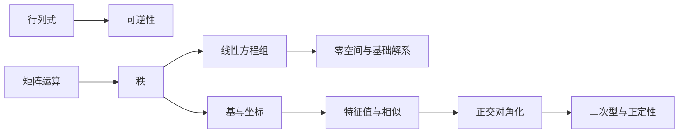

# 00 线性代数总览

> [!abstract] 重视基础的阅读入口
> 五章、29 个正文小节与对应证明，保留原有例题和 134 道章后习题。每章最后集中列出基础术语与定义；较长证明后穿插应用与几何图。
>
> 从定义出发 => 理解性质 => 看清证明 => 通过题目练习 => 回到章末查阅概念。

[[补充 证明与基础阅读导航]] · [[概念与应用导航]] · [[阅读与使用说明]] · [[数学核验与阅读约定]] · [[交付与校验说明]]

<!-- 3B1B-补充:BEGIN -->

> [!tip] 新增 · 用几何直觉读懂公式
> [[3B1B 线性代数的本质导览]]：16 节官方课程对应笔记、18 张原创图与 3 段动画；另有投影拟合与二次型能量两篇延伸。
> [[3B1B 来源与整合说明]] 说明资料来源、编辑补充和核验范围。

<!-- 3B1B-补充:END -->

## 五章导航

1. [[第一章 行列式]]
2. [[第二章 矩阵及运算]]
3. [[第三章 初等变换与线性方程组]]
4. [[第四章 向量组与线性相关性]]
5. [[第五章 相似矩阵与二次型]]

## 章末基础定义

[[01-章末 基础术语与定义]] · [[02-章末 基础术语与定义]] · [[03-章末 基础术语与定义]] · [[04-章末 基础术语与定义]] · [[05-章末 基础术语与定义]]

## 贯穿全书的联系

知识图谱的实际节点：[[概念 可逆性]]、[[概念 秩]]、[[概念 列空间]]、[[概念 零空间]]、[[概念 线性相关]]、[[概念 基与坐标]]、[[概念 正交投影]]、[[概念 特征值]]、[[概念 相似与合同]]、[[概念 正定性]]。

> [!tip] 两个量合起来才是输入空间的全部维数
> ![[概念 秩#^rank-nullity]]

## 练习入口

[[01-习题 习题一]] · [[02-习题 习题二]] · [[03-习题 习题三]] · [[04-习题 习题四]] · [[05-习题 习题五]]

## 应用入口

[[应用 资源配比与唯一解]] · [[应用 数据拟合与最小二乘]] · [[应用 人口迁移与长期比例]] · [[应用 误差代价与唯一最优点]]
