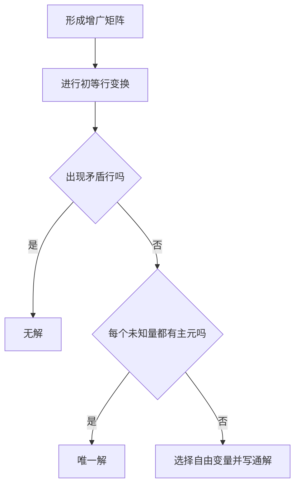

# 03-03 线性方程组的判定

[[00 线性代数总览]] · [[第三章 初等变换与线性方程组]] · [[阅读与使用说明]]

## 从矛盾行理解秩判定

原稿三组对比：

1. $x_1-x_2=0,\ x_1+x_2=2,\ x_1+x_2=4$：最后两式矛盾，无解；$R(A)<R(A\mid b)$。
2. $x_1-x_2=0,\ x_1+x_2=2,\ 3x_1-x_2=2$：$R(A)=R(A\mid b)=2$，唯一解。
3. $x_1+x_2=2,\ 2x_1+2x_2=4,\ 4x_1+4x_2=8$：$R(A)=R(A\mid b)=1<2$，无穷多解。

> [!important] 非齐次方程组 Ax=b
> 有解当且仅当 $R(A)=R(A\mid b)$。
> 有解时，若公共秩为未知数个数 $n$，解唯一；若公共秩小于 $n$，有无穷多解，自由参数个数为 $n-R(A)$。

**例 11：**
$$\begin{cases}x_1-2x_2+3x_3-x_4=1,\\3x_1-x_2+5x_3-3x_4=2,\\2x_1+x_2+2x_3-2x_4=3.\end{cases}$$
增广矩阵行化简为含行 $(0,0,0,0,-2)$ 的阶梯形，$R(A)=2<R(A\mid b)=3$，所以无解。

## 齐次方程组

> [!important] Ax=0
> $R(A)=n$ 当且仅当只有零解；$R(A)<n$ 当且仅当存在非零解，此时有无穷多解。齐次方程组总有解。

**例 10：**
$$\begin{cases}x_1+2x_2+2x_3+x_4=0,\\2x_1+x_2-2x_3-2x_4=0,\\x_1-x_2-4x_3-3x_4=0.\end{cases}$$
行最简形的两个非零行为 $(1,0,-2,-5/3)$、$(0,1,2,4/3)$。故
$$x=c_1(2,-2,1,0)^T+c_2(5/3,-4/3,0,1)^T.$$
有效约束两个，未知量四个，所以有两个自由参数。见 [[04-04 线性方程组解的结构]]。

## 原稿保留的待求例题

> [!question] 例 12
> $$\begin{cases}x_1+x_2-3x_3-x_4=1,\\3x_1-x_2-3x_3+4x_4=4,\\x_1+5x_2-9x_3-8x_4=0.\end{cases}$$
> 求通解。原稿本页没有写解答。

> [!question] 例 13：参数方程组
> $$\begin{cases}(1+\lambda)x_1+x_2+x_3=0,\\x_1+(1+\lambda)x_2+x_3=3,\\x_1+x_2+(1+\lambda)x_3=\lambda.\end{cases}$$
> $\lambda$ 何值时唯一解、无解、无穷多解？无穷多解时求通解。原稿未附解答。

> [!question] 补例：两个参数
> $$\begin{cases}ax_1+bx_2+2x_3=1,\\(b-1)x_2+x_3=0,\\ax_1+bx_2+(1-b)x_3=3-2b.\end{cases}$$
> 求 $a,b$ 何值时有解，并求解。原稿未附解答。

## 原稿末尾定理汇总

1. $Ax=0$ 有非零解 $\iff R(A)<n$；只有零解 $\iff R(A)=n$。
2. $Ax=b$ 有解 $\iff R(A)=R(A\mid b)$。
3. 矩阵方程 $AX=B$ 有解 $\iff R(A)=R(A\mid B)$，等价于 $B$ 的每一列都能由 $A$ 的列线性表示。
4. $R(AB)\le\min\{R(A),R(B)\}$。

> [!example] 补充：预算与产能约束
> 用线性方程描述恰好满足的订单、工时与材料平衡。若某些约束重复，存在调配余地；若新增约束与已有平衡矛盾，就无解。实际决策中还会有“至多”“至少”等不等式，需进一步转为线性规划，不能仅凭有无方程解判断业务可行。

<!-- 3B1B-补充:BEGIN -->

> [!tip]- 几何直觉 · 3B1B 补充
> 有解取决于右端是否可达，唯一性取决于核；含噪声数据还可以转向最近的可达输出。
>
> [[直觉07 逆矩阵列空间与零空间]] · [[直觉延伸 正交投影与最小二乘]]

<!-- 3B1B-补充:END -->

## 性质与结论的证明

![[03-03 证明 方程组的秩判定]]

## 概念连接

[[概念 零空间]] · [[概念 列空间]]

---

上一节：[[03-02 矩阵的秩与等价]] · 本章习题：[[03-习题 习题三]]

章末定义：[[03-章末 基础术语与定义]]
