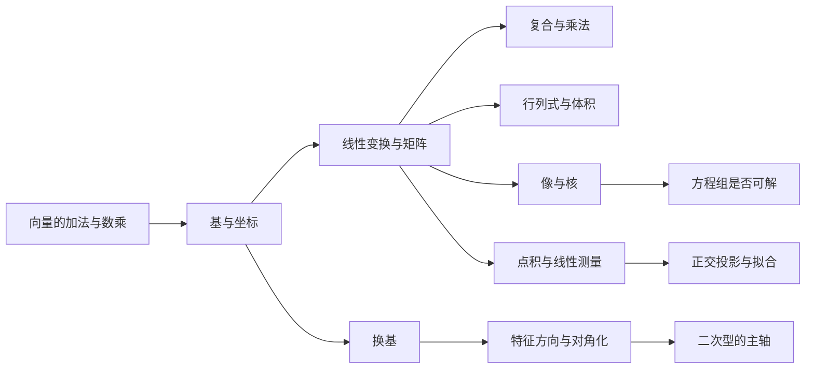

# 3B1B 线性代数的本质导览

[[00 线性代数总览]] · [[知识图谱使用指南]] · [[3B1B 来源与整合说明]]

> [!abstract] 给原来的五章补上一条几何直觉路线
> 矩阵先看成空间的动作，公式再看成这些动作的坐标记录。本补充覆盖官方配套课程的 16 节，提供 18 张原创静态图、3 段本地 GIF，以及两篇连接实际问题的延伸。
> 原来的五章、29 个正文小节、证明、章末定义和习题保持原有组织。新增文件位于 `07 几何直觉与3B1B`，它是补充目录，不是课程第七章。

## 怎样使用这份补充

1. 按讲义学习时：展开正文中的“几何直觉 · 3B1B 补充”批注，先读一幅图，再回到证明。
2. 想从直觉重走一遍：沿下面 01 → 16 的顺序阅读；数字是视频条目序号，与讲义章号无关。
3. 遇到难证明：先检查对象、输入输出空间、基和条件，再看独立构造的实例；示意图帮助理解，正式结论靠证明。
4. 在图谱中探索：打开书签中的“3B1B · 几何直觉”组，选择“几何直觉关系图（18 个主题）”。默认全书主线仍保留原来的 43 个节点。

## 16 节与五章的对应

| 节 | 几何直觉笔记 | 回到原讲义 | 官方资料 |
| --- | --- | --- | --- |
| 01 | [[直觉01 向量是动作与坐标]] | 第四章 · 线性组合 | [图文](https://www.3blue1brown.com/lessons/vectors/) · [视频](https://www.youtube.com/watch?v=fNk_zzaMoSs) |
| 02 | [[直觉02 张成空间与基]] | 第四章 · 线性相关、基 | [图文](https://www.3blue1brown.com/lessons/span/) · [视频](https://www.youtube.com/watch?v=k7RM-ot2NWY) |
| 03 | [[直觉03 矩阵怎样移动空间]] | 第二章 · 矩阵定义 | [图文](https://www.3blue1brown.com/lessons/linear-transformations/) · [视频](https://www.youtube.com/watch?v=kYB8IZa5AuE) |
| 04 | [[直觉04 矩阵乘法是变换复合]] | 第二章 · 矩阵乘法 | [图文](https://www.3blue1brown.com/lessons/matrix-multiplication/) · [视频](https://www.youtube.com/watch?v=XkY2DOUCWMU) |
| 05 | [[直觉05 三维变换与基向量]] | 第二章 · 三维与分块表达 | [图文](https://www.3blue1brown.com/lessons/3d-transformations/) · [视频](https://www.youtube.com/watch?v=rHLEWRxRGiM) |
| 06 | [[直觉06 行列式是有向体积倍率]] | 第一章 · 行列式 | [图文](https://www.3blue1brown.com/lessons/determinant/) · [视频](https://www.youtube.com/watch?v=Ip3X9LOh2dk) |
| 07 | [[直觉07 逆矩阵列空间与零空间]] | 第二、三、四章 · 逆与解空间 | [图文](https://www.3blue1brown.com/lessons/inverse-matrices/) · [视频](https://www.youtube.com/watch?v=uQhTuRlWMxw) |
| 08 | [[直觉08 矩形矩阵与维数]] | 第二、三章 · 矩阵尺寸与秩 | [图文](https://www.3blue1brown.com/lessons/nonsquare-matrices/) · [视频](https://www.youtube.com/watch?v=v8VSDg_WQlA) |
| 09 | [[直觉09 点积投影与对偶]] | 第五章 · 内积与正交 | [图文](https://www.3blue1brown.com/lessons/dot-products/) · [视频](https://www.youtube.com/watch?v=LyGKycYT2v0) |
| 10 | [[直觉10 叉积与有向面积]] | 第一、五章 · 行列式与垂直 | [图文](https://www.3blue1brown.com/lessons/cross-products/) · [视频](https://www.youtube.com/watch?v=eu6i7WJeinw) |
| 11 | [[直觉11 用体积理解叉积]] | 第一、五章 · 展开式与对偶 | [图文](https://www.3blue1brown.com/lessons/cross-products-extended/) · [视频](https://www.youtube.com/watch?v=BaM7OCEm3G0) |
| 12 | [[直觉12 克拉默法则的面积比]] | 第二章 · 克拉默法则 | [图文](https://www.3blue1brown.com/lessons/cramers-rule/) · [视频](https://www.youtube.com/watch?v=jBsC34PxzoM) |
| 13 | [[直觉13 换基是更换坐标语言]] | 第四章与第二章 · 换基、相似 | [图文](https://www.3blue1brown.com/lessons/change-of-basis/) · [视频](https://www.youtube.com/watch?v=P2LTAUO1TdA) |
| 14 | [[直觉14 特征方向与对角化]] | 第五章 · 特征值与对角化 | [图文](https://www.3blue1brown.com/lessons/eigenvalues/) · [视频](https://www.youtube.com/watch?v=PFDu9oVAE-g) |
| 15 | [[直觉15 二阶特征值的中心与间距]] | 第五章 · 二阶特征值 | [图文](https://www.3blue1brown.com/lessons/quick-eigen/) · [视频](https://www.youtube.com/watch?v=e50Bj7jn9IQ) |
| 16 | [[直觉16 函数也可以是向量]] | 第四章 · 向量空间 | [图文](https://www.3blue1brown.com/lessons/abstract-vector-spaces/) · [视频](https://www.youtube.com/watch?v=TgKwz5Ikpc8) |

## 先抓住这条因果链

## 两篇编辑延伸：接回生产与生活

- [[直觉延伸 正交投影与最小二乘]]：测量有噪声、方程无精确解时，怎样选最近的可达输出。
- [[直觉延伸 二次型的主轴与能量]]：有交叉项的代价，怎样沿自然方向拆成独立的惩罚。

## 四条短阅读路线

| 现在卡住的地方 | 建议路线 |
| --- | --- |
| 矩阵乘法只是机械计算 | [[直觉02 张成空间与基]] → [[直觉03 矩阵怎样移动空间]] → [[直觉04 矩阵乘法是变换复合]] |
| 行列式和方程组像两门课 | [[直觉06 行列式是有向体积倍率]] → [[直觉07 逆矩阵列空间与零空间]] → [[直觉12 克拉默法则的面积比]] |
| 内积、投影、叉积容易混 | [[直觉09 点积投影与对偶]] → [[直觉10 叉积与有向面积]] → [[直觉11 用体积理解叉积]] |
| 换基、相似、合同总记反 | [[直觉13 换基是更换坐标语言]] → [[直觉14 特征方向与对角化]] → [[直觉延伸 二次型的主轴与能量]] |

> [!info] 图与动画的阅读约定
> 静态图直接嵌入，动画放在可折叠 callout 中，需要时再展开。三维图采用屏幕投影，没有要求安装 3D 插件；请结合坐标读图，不要凭屏幕上的夹角认定空间中垂直。

## 基础名词去哪里查

每篇直觉笔记末尾都有最小词典；原五章的详细词典仍在每章最后：[[01-章末 基础术语与定义]]、[[02-章末 基础术语与定义]]、[[03-章末 基础术语与定义]]、[[04-章末 基础术语与定义]]、[[05-章末 基础术语与定义]]。
