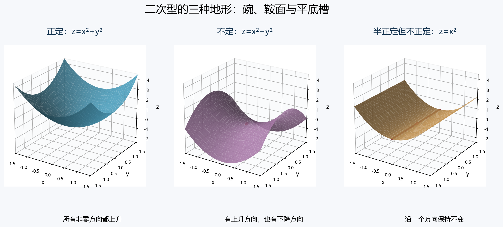
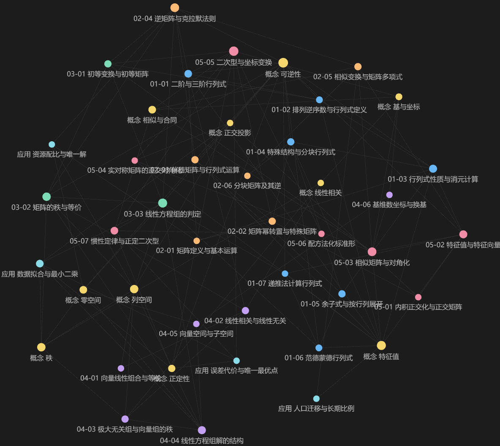

# Linear Algebra · 线性代数

**面向第一次学习大学线性代数的同学，按同济版《线性代数》第七版的内容与学习顺序整理。**

这份笔记的主体内容依据孔祥仁老师《线性代数》正课的手写板书 PDF 整理，希望能作为教材和课堂之外的一份同步辅导：把定义、符号、计算步骤和容易卡住的地方尽量讲细，方便你跟着学、回头查。

我希望普通高中高一阶段的学生也能掌握其中的逻辑链和推导（只需要最基础的函数和数列知识，以及一点记忆力），因此会尽量从基本功讲起，不默认读者已经学过线性代数。同时，我特别关心这些知识怎样用于现实问题，所以加入了几何直觉与应用方面的补充。

> **当前版本请先了解：** Markdown 主体内容由 AI 根据孔祥仁老师的手写板书 PDF 转写，并加入了 AI 补充内容，**目前尚未开始人工逐项核对**。公式、符号、题面和解释都可能存在转写失真或内容错误；阅读时请结合教材核对。原始手写板书 PDF 和独立的证明 PDF 均计划后续上传，目前尚未发布。
> 请大家务必保持批判性阅读！

## 配套网课与致谢

我学习的是 **孔祥仁老师** 的线性代数课程：

- **正课：** [《线性代数》正课，零废话，超精讲！【孔祥仁】](https://www.bilibili.com/video/BV1KM411V7gv/)
- **习题课：** [线性代数课后习题讲解](https://www.bilibili.com/video/BV1bt421T7p6/)

非常感谢孔祥仁老师。他讲得真的很好，课程讲解和手写板书给我的学习带来了很大帮助，也是这份 Markdown 笔记主体内容的来源。希望这份整理能方便大家跟着老师的课程学习、复习和查找。

建议先跟着正课理解概念与例题，独立做完相关习题后，再按需观看习题课。

## 下载与打开

笔记通过 **Obsidian** 阅读。第一次使用不需要会 Git，也不需要安装额外的社区插件。

1. 安装 [Obsidian](https://obsidian.md/download)。
2. 打开项目的 [Releases 下载页](https://github.com/ljl510824/linear-algebra/releases)，在相应版本的 **Assets** 中下载笔记 ZIP 包。当前文件名为 `linear-algebra-obsidian-v1.0.0.zip`。
3. 解压 ZIP。在 Obsidian 的仓库管理界面选择“打开文件夹作为仓库”，选中同时包含 `00 线性代数总览.md` 和 `.obsidian` 文件夹的那一层目录。如果解压后多套了一层文件夹，请进入里面再选。
4. 在 Obsidian 左侧文件列表中打开 **`00 线性代数总览`**，再进入你正在学习的章节。
5. 打开侧栏的知识图谱，你会看到令人惊叹的蛛网图。

> 证明和修补还在路上，请保持评判性阅读

这里的“仓库”是 Obsidian 对笔记文件夹的称呼，不需要连接 GitHub 账号。

想先看看内容，可以直接打开 [第一节：二阶与三阶行列式](01%20%E8%A1%8C%E5%88%97%E5%BC%8F/01-01%20%E4%BA%8C%E9%98%B6%E4%B8%8E%E4%B8%89%E9%98%B6%E8%A1%8C%E5%88%97%E5%BC%8F.md)。笔记中使用了 Obsidian 的内部链接和嵌入语法，GitHub 网页上部分链接、嵌入内容的显示可能不完整，完整阅读建议下载后打开。

## 第一次学习，怎么读？

**先跟着网课学习，不要跳着看，开启下一节网课的标准是上一节网课所有的例题你可以轻松理解；当你遇到需要时，再看证明、几何直觉与应用补充。**

以第一章为例：

1. 从总览进入“第一章 行列式”，打开“二阶与三阶行列式”。如果你的学校已经教到后面的内容，也可以直接进入对应小节。
2. 跟着网课，先读定义和计算规则，拿纸笔把例题算一遍。遇到不熟悉的术语，可以查本章的“基础术语与定义”。
3. 学完相关内容后做本章习题，再回到正文查自己没有掌握的地方。
4. 想弄清一个结论为什么成立，再读对应证明；想知道公式在几何上表示什么，再打开 3B1B 补充；想了解用途，再看应用专题。这些内容可以按需阅读。
5. 当然，以上只是我的经验之谈，适合自己的最重要，就做你自己！

正文中已经插入了一些几何直觉与证明入口，第一次读不必把所有链接都点开。先读完当前小节、跟上教材进度即可。

### 习题为什么没有答案？

章后习题全部沿用同济版《线性代数》第七版的课后习题，没有另行改编，**不附习题答案是有意的安排**。建议先独立完成，再自行查找对应版本、章节和题号的解答核对；题面如有疑问，请对照教材原题。另外，也可以结合孔祥仁老师的[习题课](https://www.bilibili.com/video/BV1bt421T7p6/)核对思路。

## 内容导航

完整的小节目录见 [线性代数总览](00%20%E7%BA%BF%E6%80%A7%E4%BB%A3%E6%95%B0%E6%80%BB%E8%A7%88.md)。首页只保留五大章节的入口，方便按学习进度查找。

| 入口 | 主要内容 |
| --- | --- |
| [第一章：行列式](01%20%E8%A1%8C%E5%88%97%E5%BC%8F/%E7%AC%AC%E4%B8%80%E7%AB%A0%20%E8%A1%8C%E5%88%97%E5%BC%8F.md) | 行列式的定义、性质、展开与计算 |
| [第二章：矩阵及运算](02%20%E7%9F%A9%E9%98%B5%E5%8F%8A%E8%BF%90%E7%AE%97/%E7%AC%AC%E4%BA%8C%E7%AB%A0%20%E7%9F%A9%E9%98%B5%E5%8F%8A%E8%BF%90%E7%AE%97.md) | 矩阵运算、逆矩阵、分块矩阵等 |
| [第三章：初等变换与线性方程组](03%20%E5%88%9D%E7%AD%89%E5%8F%98%E6%8D%A2%E4%B8%8E%E7%BA%BF%E6%80%A7%E6%96%B9%E7%A8%8B%E7%BB%84/%E7%AC%AC%E4%B8%89%E7%AB%A0%20%E5%88%9D%E7%AD%89%E5%8F%98%E6%8D%A2%E4%B8%8E%E7%BA%BF%E6%80%A7%E6%96%B9%E7%A8%8B%E7%BB%84.md) | 初等变换、矩阵的秩、线性方程组 |
| [第四章：向量组与线性相关性](04%20%E5%90%91%E9%87%8F%E7%BB%84%E4%B8%8E%E7%BA%BF%E6%80%A7%E7%9B%B8%E5%85%B3%E6%80%A7/%E7%AC%AC%E5%9B%9B%E7%AB%A0%20%E5%90%91%E9%87%8F%E7%BB%84%E4%B8%8E%E7%BA%BF%E6%80%A7%E7%9B%B8%E5%85%B3%E6%80%A7.md) | 线性相关、解的结构、向量空间、基与坐标 |
| [第五章：相似矩阵与二次型](05%20%E7%9B%B8%E4%BC%BC%E7%9F%A9%E9%98%B5%E4%B8%8E%E4%BA%8C%E6%AC%A1%E5%9E%8B/%E7%AC%AC%E4%BA%94%E7%AB%A0%20%E7%9B%B8%E4%BC%BC%E7%9F%A9%E9%98%B5%E4%B8%8E%E4%BA%8C%E6%AC%A1%E5%9E%8B.md) | 内积与正交、特征值、对角化、二次型 |
| [概念与应用](%E6%A6%82%E5%BF%B5%E4%B8%8E%E5%BA%94%E7%94%A8%E5%AF%BC%E8%88%AA.md) | 联系不同章节的概念，以及配比、拟合等应用示例 |
| [3B1B 几何直觉补充](07%20%E5%87%A0%E4%BD%95%E7%9B%B4%E8%A7%89%E4%B8%8E3B1B/3B1B%20%E7%BA%BF%E6%80%A7%E4%BB%A3%E6%95%B0%E7%9A%84%E6%9C%AC%E8%B4%A8%E5%AF%BC%E8%A7%88.md) | 从空间与变换的角度理解矩阵、行列式等内容 |

## 几何直觉

### 二次型的三种地形

*图一 · 二次型的三种地形：正定对应所有非零方向都上升的碗；不定对应既有上升方向也有下降方向的鞍面；半正定但不正定的例子则沿一个方向保持不变。*

### 用体积理解叉积

*图二 · 固定两条底边，第三条边的有向高度决定有向体积；叉积是这个体积测量所对应的法向量。*

## 知识图谱

需要查知识之间的联系时，强烈推荐用 Obsidian 的知识图谱，操作见 [知识图谱使用指南](%E7%9F%A5%E8%AF%86%E5%9B%BE%E8%B0%B1%E4%BD%BF%E7%94%A8%E6%8C%87%E5%8D%97.md)。刚开始阅读时，直接用章节目录即可。

*在 Obsidian 中查看笔记之间的联系：主线按章节、概念与应用分色，也可以通过书签进入分章图谱和几何直觉图谱。*

## 内容来源与整理进度

五章主体主要依据**孔祥仁老师的手写板书 PDF**，经 AI 转写为 Markdown，并结合我的学习记录整理。课程讲解与板书内容来自孔祥仁老师；现有 Markdown 不能保证逐字、逐式保留了原稿，也可能混入转写、整理时的改写与补充。

几何直觉部分由 AI 参考 **3Blue1Brown（3B1B）《线性代数的本质》**系列相关材料补充整理，未经我的人工核对。阅读时可以结合 [3Blue1Brown 官方课程](https://www.3blue1brown.com/topics/linear-algebra) 对照理解。

现实问题与应用示例也是由 AI 补充的。我加入这些内容，是希望读者学习时能同时思考“它可以用来解决什么问题”。其中的场景、模型假设和推导仍需要核对。

我自己目前大约学完了该课程内容的 **80%**，这份笔记也会随学习继续整理。目前的进度是：

- **人工校对：** 尚未开始。仓库中已有的检查记录或“核验”表述，不代表我已完成逐项人工审校。
- **原始手写板书 PDF：** 计划上传到 [Releases](https://github.com/ljl510824/linear-algebra/releases)，供读者对照孔祥仁老师的原始板书。
- **独立证明 PDF：** 计划后续整理上传。仓库目前已有一些证明相关内容，同样尚未经我人工核对。

## 发现问题怎么办？

欢迎在 [Issues](https://github.com/ljl510824/linear-algebra/issues) 提交勘误或阅读反馈。请尽量写清：

- 哪一篇笔记、哪个小节；
- 存在问题的公式、题目或原句；
- 你认为哪里有误，以及可供对照的教材页码或推导。

如果只是某一步没看懂，也可以指出具体卡住的位置，这能帮助我判断哪些地方需要补充说明。当然，鼓励大家使用最前沿的ai，只要提示词得当，一定是收获很大的。当我在空教室写下这篇文章时，~~Claude已经宣布解决了著名的黎曼猜想~~

## 一些想说的话

- 珍惜时间，别因为听不懂课就放弃，从0到1的阶段是最珍贵的，坚持刷完一本书，看完系统的网课，这样才能入门。
- 王羲之在《兰亭集序》中写到：夫人之相与，俯仰一世，或取诸怀抱，悟言一室之内；或因寄所托，放浪形骸之外。我也推荐大家不要局限于课堂的学习和刷题，在没课的午后，找一间空教室，打开电脑上面的前沿ai，和几个交心的朋友一起交流数学，解决难题，这会是一笔宝贵的财富。
- 靠刷题学不好大学的内容。
- 有兴趣的话看一下我其他项目啊喂！
