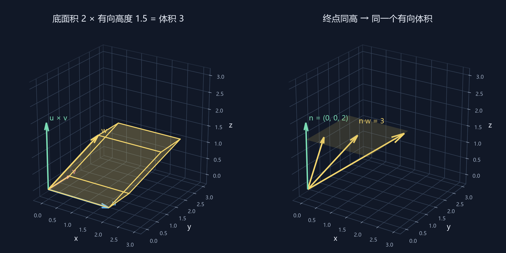

# Linear Algebra · 线性代数

## 使用方法：下载 → 解压 → 导入 Obsidian 仓库

1. **[下载打包好的 ZIP 仓库](https://github.com/ljl510824/linear-algebra/releases/latest/download/linear-algebra-obsidian-v1.0.0.zip)**，或进入 [Releases](https://github.com/ljl510824/linear-algebra/releases/latest)，在 **Assets** 中下载 `linear-algebra-obsidian-v1.0.0.zip`。
2. **解压 ZIP**，得到 `linear-algebra` 文件夹。
3. 打开 Obsidian，在仓库管理界面选择 **“打开文件夹作为仓库” → “打开”**，选中解压后的 `linear-algebra` 文件夹（里面包含 `.obsidian` 和 `00 线性代数总览.md`）。
4. 打开 **`00 线性代数总览`** 开始阅读；通过书签进入分章目录、知识图谱或 3B1B 几何直觉笔记。

> 证明和修补还在路上，请保持评判性阅读

> ZIP 已包含全部笔记、图片、GIF 和图谱配置，解压即可使用，无需额外安装社区插件。请先在电脑上安装 [Obsidian](https://obsidian.md/download)。

一套重视基础、证明与几何直觉的中文 **Obsidian 线性代数笔记**。从手写课程讲义整理为 Markdown，在五章课程的基础上补充性质与结论的证明、章末术语表、实际应用，以及结合 **3Blue1Brown《线性代数的本质》** 官方配套课程编写的直觉笔记与原创数学图。

**5 章课程 · 29 个正文小节 · 29 篇配套证明 · 134 道章后习题 · 16 篇 3B1B 直觉笔记**

**从这里开始：** [课程总览](00%20%E7%BA%BF%E6%80%A7%E4%BB%A3%E6%95%B0%E6%80%BB%E8%A7%88.md) · [证明与基础阅读导航](%E8%A1%A5%E5%85%85%20%E8%AF%81%E6%98%8E%E4%B8%8E%E5%9F%BA%E7%A1%80%E9%98%85%E8%AF%BB%E5%AF%BC%E8%88%AA.md) · [3B1B 几何直觉导览](07%20%E5%87%A0%E4%BD%95%E7%9B%B4%E8%A7%89%E4%B8%8E3B1B/3B1B%20%E7%BA%BF%E6%80%A7%E4%BB%A3%E6%95%B0%E7%9A%84%E6%9C%AC%E8%B4%A8%E5%AF%BC%E8%A7%88.md)

## 看见公式背后的空间



*原创三维示意：固定两条底边，第三条边的有向高度决定体积；叉积就是这个体积测量所对应的法向量。*

## 笔记目录

五章采用“正文 → 配套证明 → 习题 → 章末基础定义”的结构；概念应用与几何直觉放在独立补充目录，通过内部链接连接到相关正文。

| 目录 | 主要内容 | 配套资料 |
| --- | --- | --- |
| [第一章 行列式](01%20%E8%A1%8C%E5%88%97%E5%BC%8F/%E7%AC%AC%E4%B8%80%E7%AB%A0%20%E8%A1%8C%E5%88%97%E5%BC%8F.md) | 行列式定义、性质、展开与计算方法 | 配套证明 · 习题 · [基础词典](01%20%E8%A1%8C%E5%88%97%E5%BC%8F/01-%E7%AB%A0%E6%9C%AB%20%E5%9F%BA%E7%A1%80%E6%9C%AF%E8%AF%AD%E4%B8%8E%E5%AE%9A%E4%B9%89.md) |
| [第二章 矩阵及运算](02%20%E7%9F%A9%E9%98%B5%E5%8F%8A%E8%BF%90%E7%AE%97/%E7%AC%AC%E4%BA%8C%E7%AB%A0%20%E7%9F%A9%E9%98%B5%E5%8F%8A%E8%BF%90%E7%AE%97.md) | 矩阵运算、逆矩阵、相似与分块 | 配套证明 · 习题 · [基础词典](02%20%E7%9F%A9%E9%98%B5%E5%8F%8A%E8%BF%90%E7%AE%97/02-%E7%AB%A0%E6%9C%AB%20%E5%9F%BA%E7%A1%80%E6%9C%AF%E8%AF%AD%E4%B8%8E%E5%AE%9A%E4%B9%89.md) |
| [第三章 初等变换与线性方程组](03%20%E5%88%9D%E7%AD%89%E5%8F%98%E6%8D%A2%E4%B8%8E%E7%BA%BF%E6%80%A7%E6%96%B9%E7%A8%8B%E7%BB%84/%E7%AC%AC%E4%B8%89%E7%AB%A0%20%E5%88%9D%E7%AD%89%E5%8F%98%E6%8D%A2%E4%B8%8E%E7%BA%BF%E6%80%A7%E6%96%B9%E7%A8%8B%E7%BB%84.md) | 初等变换、矩阵的秩、方程组判定 | 配套证明 · 习题 · [基础词典](03%20%E5%88%9D%E7%AD%89%E5%8F%98%E6%8D%A2%E4%B8%8E%E7%BA%BF%E6%80%A7%E6%96%B9%E7%A8%8B%E7%BB%84/03-%E7%AB%A0%E6%9C%AB%20%E5%9F%BA%E7%A1%80%E6%9C%AF%E8%AF%AD%E4%B8%8E%E5%AE%9A%E4%B9%89.md) |
| [第四章 向量组与线性相关性](04%20%E5%90%91%E9%87%8F%E7%BB%84%E4%B8%8E%E7%BA%BF%E6%80%A7%E7%9B%B8%E5%85%B3%E6%80%A7/%E7%AC%AC%E5%9B%9B%E7%AB%A0%20%E5%90%91%E9%87%8F%E7%BB%84%E4%B8%8E%E7%BA%BF%E6%80%A7%E7%9B%B8%E5%85%B3%E6%80%A7.md) | 线性组合、相关性、解空间、基与坐标 | 配套证明 · 习题 · [基础词典](04%20%E5%90%91%E9%87%8F%E7%BB%84%E4%B8%8E%E7%BA%BF%E6%80%A7%E7%9B%B8%E5%85%B3%E6%80%A7/04-%E7%AB%A0%E6%9C%AB%20%E5%9F%BA%E7%A1%80%E6%9C%AF%E8%AF%AD%E4%B8%8E%E5%AE%9A%E4%B9%89.md) |
| [第五章 相似矩阵与二次型](05%20%E7%9B%B8%E4%BC%BC%E7%9F%A9%E9%98%B5%E4%B8%8E%E4%BA%8C%E6%AC%A1%E5%9E%8B/%E7%AC%AC%E4%BA%94%E7%AB%A0%20%E7%9B%B8%E4%BC%BC%E7%9F%A9%E9%98%B5%E4%B8%8E%E4%BA%8C%E6%AC%A1%E5%9E%8B.md) | 内积、特征值、对角化、二次型与正定性 | 配套证明 · 习题 · [基础词典](05%20%E7%9B%B8%E4%BC%BC%E7%9F%A9%E9%98%B5%E4%B8%8E%E4%BA%8C%E6%AC%A1%E5%9E%8B/05-%E7%AB%A0%E6%9C%AB%20%E5%9F%BA%E7%A1%80%E6%9C%AF%E8%AF%AD%E4%B8%8E%E5%AE%9A%E4%B9%89.md) |
| [06 概念与应用](%E6%A6%82%E5%BF%B5%E4%B8%8E%E5%BA%94%E7%94%A8%E5%AF%BC%E8%88%AA.md) | 10 个核心概念、4 个应用专题 | 跨章节概念联系 |
| [07 几何直觉与3B1B](07%20%E5%87%A0%E4%BD%95%E7%9B%B4%E8%A7%89%E4%B8%8E3B1B/3B1B%20%E7%BA%BF%E6%80%A7%E4%BB%A3%E6%95%B0%E7%9A%84%E6%9C%AC%E8%B4%A8%E5%AF%BC%E8%A7%88.md) | 16 节直觉笔记、2 篇应用延伸 | 18 张原创静态图、3 段 GIF |

### 第一章 行列式

- [二阶与三阶行列式](01%20%E8%A1%8C%E5%88%97%E5%BC%8F/01-01%20%E4%BA%8C%E9%98%B6%E4%B8%8E%E4%B8%89%E9%98%B6%E8%A1%8C%E5%88%97%E5%BC%8F.md)
- [排列逆序数与行列式定义](01%20%E8%A1%8C%E5%88%97%E5%BC%8F/01-02%20%E6%8E%92%E5%88%97%E9%80%86%E5%BA%8F%E6%95%B0%E4%B8%8E%E8%A1%8C%E5%88%97%E5%BC%8F%E5%AE%9A%E4%B9%89.md)
- [行列式性质与消元计算](01%20%E8%A1%8C%E5%88%97%E5%BC%8F/01-03%20%E8%A1%8C%E5%88%97%E5%BC%8F%E6%80%A7%E8%B4%A8%E4%B8%8E%E6%B6%88%E5%85%83%E8%AE%A1%E7%AE%97.md)
- [特殊结构与分块行列式](01%20%E8%A1%8C%E5%88%97%E5%BC%8F/01-04%20%E7%89%B9%E6%AE%8A%E7%BB%93%E6%9E%84%E4%B8%8E%E5%88%86%E5%9D%97%E8%A1%8C%E5%88%97%E5%BC%8F.md)
- [余子式与按行列展开](01%20%E8%A1%8C%E5%88%97%E5%BC%8F/01-05%20%E4%BD%99%E5%AD%90%E5%BC%8F%E4%B8%8E%E6%8C%89%E8%A1%8C%E5%88%97%E5%B1%95%E5%BC%80.md)
- [范德蒙德行列式](01%20%E8%A1%8C%E5%88%97%E5%BC%8F/01-06%20%E8%8C%83%E5%BE%B7%E8%92%99%E5%BE%B7%E8%A1%8C%E5%88%97%E5%BC%8F.md)
- [递推法计算行列式](01%20%E8%A1%8C%E5%88%97%E5%BC%8F/01-07%20%E9%80%92%E6%8E%A8%E6%B3%95%E8%AE%A1%E7%AE%97%E8%A1%8C%E5%88%97%E5%BC%8F.md)

### 第二章 矩阵及运算

- [矩阵定义与基本运算](02%20%E7%9F%A9%E9%98%B5%E5%8F%8A%E8%BF%90%E7%AE%97/02-01%20%E7%9F%A9%E9%98%B5%E5%AE%9A%E4%B9%89%E4%B8%8E%E5%9F%BA%E6%9C%AC%E8%BF%90%E7%AE%97.md)
- [矩阵幂转置与特殊矩阵](02%20%E7%9F%A9%E9%98%B5%E5%8F%8A%E8%BF%90%E7%AE%97/02-02%20%E7%9F%A9%E9%98%B5%E5%B9%82%E8%BD%AC%E7%BD%AE%E4%B8%8E%E7%89%B9%E6%AE%8A%E7%9F%A9%E9%98%B5.md)
- [伴随矩阵与行列式运算](02%20%E7%9F%A9%E9%98%B5%E5%8F%8A%E8%BF%90%E7%AE%97/02-03%20%E4%BC%B4%E9%9A%8F%E7%9F%A9%E9%98%B5%E4%B8%8E%E8%A1%8C%E5%88%97%E5%BC%8F%E8%BF%90%E7%AE%97.md)
- [逆矩阵与克拉默法则](02%20%E7%9F%A9%E9%98%B5%E5%8F%8A%E8%BF%90%E7%AE%97/02-04%20%E9%80%86%E7%9F%A9%E9%98%B5%E4%B8%8E%E5%85%8B%E6%8B%89%E9%BB%98%E6%B3%95%E5%88%99.md)
- [相似变换与矩阵多项式](02%20%E7%9F%A9%E9%98%B5%E5%8F%8A%E8%BF%90%E7%AE%97/02-05%20%E7%9B%B8%E4%BC%BC%E5%8F%98%E6%8D%A2%E4%B8%8E%E7%9F%A9%E9%98%B5%E5%A4%9A%E9%A1%B9%E5%BC%8F.md)
- [分块矩阵及其逆](02%20%E7%9F%A9%E9%98%B5%E5%8F%8A%E8%BF%90%E7%AE%97/02-06%20%E5%88%86%E5%9D%97%E7%9F%A9%E9%98%B5%E5%8F%8A%E5%85%B6%E9%80%86.md)

### 第三章 初等变换与线性方程组

- [初等变换与初等矩阵](03%20%E5%88%9D%E7%AD%89%E5%8F%98%E6%8D%A2%E4%B8%8E%E7%BA%BF%E6%80%A7%E6%96%B9%E7%A8%8B%E7%BB%84/03-01%20%E5%88%9D%E7%AD%89%E5%8F%98%E6%8D%A2%E4%B8%8E%E5%88%9D%E7%AD%89%E7%9F%A9%E9%98%B5.md)
- [矩阵的秩与等价](03%20%E5%88%9D%E7%AD%89%E5%8F%98%E6%8D%A2%E4%B8%8E%E7%BA%BF%E6%80%A7%E6%96%B9%E7%A8%8B%E7%BB%84/03-02%20%E7%9F%A9%E9%98%B5%E7%9A%84%E7%A7%A9%E4%B8%8E%E7%AD%89%E4%BB%B7.md)
- [线性方程组的判定](03%20%E5%88%9D%E7%AD%89%E5%8F%98%E6%8D%A2%E4%B8%8E%E7%BA%BF%E6%80%A7%E6%96%B9%E7%A8%8B%E7%BB%84/03-03%20%E7%BA%BF%E6%80%A7%E6%96%B9%E7%A8%8B%E7%BB%84%E7%9A%84%E5%88%A4%E5%AE%9A.md)

### 第四章 向量组与线性相关性

- [向量线性组合与等价](04%20%E5%90%91%E9%87%8F%E7%BB%84%E4%B8%8E%E7%BA%BF%E6%80%A7%E7%9B%B8%E5%85%B3%E6%80%A7/04-01%20%E5%90%91%E9%87%8F%E7%BA%BF%E6%80%A7%E7%BB%84%E5%90%88%E4%B8%8E%E7%AD%89%E4%BB%B7.md)
- [线性相关与线性无关](04%20%E5%90%91%E9%87%8F%E7%BB%84%E4%B8%8E%E7%BA%BF%E6%80%A7%E7%9B%B8%E5%85%B3%E6%80%A7/04-02%20%E7%BA%BF%E6%80%A7%E7%9B%B8%E5%85%B3%E4%B8%8E%E7%BA%BF%E6%80%A7%E6%97%A0%E5%85%B3.md)
- [极大无关组与向量组的秩](04%20%E5%90%91%E9%87%8F%E7%BB%84%E4%B8%8E%E7%BA%BF%E6%80%A7%E7%9B%B8%E5%85%B3%E6%80%A7/04-03%20%E6%9E%81%E5%A4%A7%E6%97%A0%E5%85%B3%E7%BB%84%E4%B8%8E%E5%90%91%E9%87%8F%E7%BB%84%E7%9A%84%E7%A7%A9.md)
- [线性方程组解的结构](04%20%E5%90%91%E9%87%8F%E7%BB%84%E4%B8%8E%E7%BA%BF%E6%80%A7%E7%9B%B8%E5%85%B3%E6%80%A7/04-04%20%E7%BA%BF%E6%80%A7%E6%96%B9%E7%A8%8B%E7%BB%84%E8%A7%A3%E7%9A%84%E7%BB%93%E6%9E%84.md)
- [向量空间与子空间](04%20%E5%90%91%E9%87%8F%E7%BB%84%E4%B8%8E%E7%BA%BF%E6%80%A7%E7%9B%B8%E5%85%B3%E6%80%A7/04-05%20%E5%90%91%E9%87%8F%E7%A9%BA%E9%97%B4%E4%B8%8E%E5%AD%90%E7%A9%BA%E9%97%B4.md)
- [基维数坐标与换基](04%20%E5%90%91%E9%87%8F%E7%BB%84%E4%B8%8E%E7%BA%BF%E6%80%A7%E7%9B%B8%E5%85%B3%E6%80%A7/04-06%20%E5%9F%BA%E7%BB%B4%E6%95%B0%E5%9D%90%E6%A0%87%E4%B8%8E%E6%8D%A2%E5%9F%BA.md)

### 第五章 相似矩阵与二次型

- [内积正交化与正交矩阵](05%20%E7%9B%B8%E4%BC%BC%E7%9F%A9%E9%98%B5%E4%B8%8E%E4%BA%8C%E6%AC%A1%E5%9E%8B/05-01%20%E5%86%85%E7%A7%AF%E6%AD%A3%E4%BA%A4%E5%8C%96%E4%B8%8E%E6%AD%A3%E4%BA%A4%E7%9F%A9%E9%98%B5.md)
- [特征值与特征向量](05%20%E7%9B%B8%E4%BC%BC%E7%9F%A9%E9%98%B5%E4%B8%8E%E4%BA%8C%E6%AC%A1%E5%9E%8B/05-02%20%E7%89%B9%E5%BE%81%E5%80%BC%E4%B8%8E%E7%89%B9%E5%BE%81%E5%90%91%E9%87%8F.md)
- [相似矩阵与对角化](05%20%E7%9B%B8%E4%BC%BC%E7%9F%A9%E9%98%B5%E4%B8%8E%E4%BA%8C%E6%AC%A1%E5%9E%8B/05-03%20%E7%9B%B8%E4%BC%BC%E7%9F%A9%E9%98%B5%E4%B8%8E%E5%AF%B9%E8%A7%92%E5%8C%96.md)
- [实对称矩阵的正交对角化](05%20%E7%9B%B8%E4%BC%BC%E7%9F%A9%E9%98%B5%E4%B8%8E%E4%BA%8C%E6%AC%A1%E5%9E%8B/05-04%20%E5%AE%9E%E5%AF%B9%E7%A7%B0%E7%9F%A9%E9%98%B5%E7%9A%84%E6%AD%A3%E4%BA%A4%E5%AF%B9%E8%A7%92%E5%8C%96.md)
- [二次型与坐标变换](05%20%E7%9B%B8%E4%BC%BC%E7%9F%A9%E9%98%B5%E4%B8%8E%E4%BA%8C%E6%AC%A1%E5%9E%8B/05-05%20%E4%BA%8C%E6%AC%A1%E5%9E%8B%E4%B8%8E%E5%9D%90%E6%A0%87%E5%8F%98%E6%8D%A2.md)
- [配方法化标准形](05%20%E7%9B%B8%E4%BC%BC%E7%9F%A9%E9%98%B5%E4%B8%8E%E4%BA%8C%E6%AC%A1%E5%9E%8B/05-06%20%E9%85%8D%E6%96%B9%E6%B3%95%E5%8C%96%E6%A0%87%E5%87%86%E5%BD%A2.md)
- [惯性定律与正定二次型](05%20%E7%9B%B8%E4%BC%BC%E7%9F%A9%E9%98%B5%E4%B8%8E%E4%BA%8C%E6%AC%A1%E5%9E%8B/05-07%20%E6%83%AF%E6%80%A7%E5%AE%9A%E5%BE%8B%E4%B8%8E%E6%AD%A3%E5%AE%9A%E4%BA%8C%E6%AC%A1%E5%9E%8B.md)

### 概念与实际应用

**核心概念：** [可逆性](06%20%E6%A6%82%E5%BF%B5%E4%B8%8E%E5%BA%94%E7%94%A8/%E6%A6%82%E5%BF%B5%20%E5%8F%AF%E9%80%86%E6%80%A7.md) · [秩](06%20%E6%A6%82%E5%BF%B5%E4%B8%8E%E5%BA%94%E7%94%A8/%E6%A6%82%E5%BF%B5%20%E7%A7%A9.md) · [列空间](06%20%E6%A6%82%E5%BF%B5%E4%B8%8E%E5%BA%94%E7%94%A8/%E6%A6%82%E5%BF%B5%20%E5%88%97%E7%A9%BA%E9%97%B4.md) · [零空间](06%20%E6%A6%82%E5%BF%B5%E4%B8%8E%E5%BA%94%E7%94%A8/%E6%A6%82%E5%BF%B5%20%E9%9B%B6%E7%A9%BA%E9%97%B4.md) · [线性相关](06%20%E6%A6%82%E5%BF%B5%E4%B8%8E%E5%BA%94%E7%94%A8/%E6%A6%82%E5%BF%B5%20%E7%BA%BF%E6%80%A7%E7%9B%B8%E5%85%B3.md) · [基与坐标](06%20%E6%A6%82%E5%BF%B5%E4%B8%8E%E5%BA%94%E7%94%A8/%E6%A6%82%E5%BF%B5%20%E5%9F%BA%E4%B8%8E%E5%9D%90%E6%A0%87.md) · [正交投影](06%20%E6%A6%82%E5%BF%B5%E4%B8%8E%E5%BA%94%E7%94%A8/%E6%A6%82%E5%BF%B5%20%E6%AD%A3%E4%BA%A4%E6%8A%95%E5%BD%B1.md) · [特征值](06%20%E6%A6%82%E5%BF%B5%E4%B8%8E%E5%BA%94%E7%94%A8/%E6%A6%82%E5%BF%B5%20%E7%89%B9%E5%BE%81%E5%80%BC.md) · [相似与合同](06%20%E6%A6%82%E5%BF%B5%E4%B8%8E%E5%BA%94%E7%94%A8/%E6%A6%82%E5%BF%B5%20%E7%9B%B8%E4%BC%BC%E4%B8%8E%E5%90%88%E5%90%8C.md) · [正定性](06%20%E6%A6%82%E5%BF%B5%E4%B8%8E%E5%BA%94%E7%94%A8/%E6%A6%82%E5%BF%B5%20%E6%AD%A3%E5%AE%9A%E6%80%A7.md)。

**应用专题：** [资源配比与唯一解](06%20%E6%A6%82%E5%BF%B5%E4%B8%8E%E5%BA%94%E7%94%A8/%E5%BA%94%E7%94%A8%20%E8%B5%84%E6%BA%90%E9%85%8D%E6%AF%94%E4%B8%8E%E5%94%AF%E4%B8%80%E8%A7%A3.md) · [数据拟合与最小二乘](06%20%E6%A6%82%E5%BF%B5%E4%B8%8E%E5%BA%94%E7%94%A8/%E5%BA%94%E7%94%A8%20%E6%95%B0%E6%8D%AE%E6%8B%9F%E5%90%88%E4%B8%8E%E6%9C%80%E5%B0%8F%E4%BA%8C%E4%B9%98.md) · [人口迁移与长期比例](06%20%E6%A6%82%E5%BF%B5%E4%B8%8E%E5%BA%94%E7%94%A8/%E5%BA%94%E7%94%A8%20%E4%BA%BA%E5%8F%A3%E8%BF%81%E7%A7%BB%E4%B8%8E%E9%95%BF%E6%9C%9F%E6%AF%94%E4%BE%8B.md) · [误差代价与唯一最优点](06%20%E6%A6%82%E5%BF%B5%E4%B8%8E%E5%BA%94%E7%94%A8/%E5%BA%94%E7%94%A8%20%E8%AF%AF%E5%B7%AE%E4%BB%A3%E4%BB%B7%E4%B8%8E%E5%94%AF%E4%B8%80%E6%9C%80%E4%BC%98%E7%82%B9.md)。

### 3B1B 几何直觉补充

围绕“基向量的落点决定变换”展开，把矩阵、行列式、核与像、内积、换基和特征方向串起来。相关入口已加入 25 个正文小节，以可折叠 callout 呈现。

<details>
<summary>展开 16 节直觉笔记目录</summary>

- [直觉01 向量是动作与坐标](07%20%E5%87%A0%E4%BD%95%E7%9B%B4%E8%A7%89%E4%B8%8E3B1B/%E7%9B%B4%E8%A7%8901%20%E5%90%91%E9%87%8F%E6%98%AF%E5%8A%A8%E4%BD%9C%E4%B8%8E%E5%9D%90%E6%A0%87.md)
- [直觉02 张成空间与基](07%20%E5%87%A0%E4%BD%95%E7%9B%B4%E8%A7%89%E4%B8%8E3B1B/%E7%9B%B4%E8%A7%8902%20%E5%BC%A0%E6%88%90%E7%A9%BA%E9%97%B4%E4%B8%8E%E5%9F%BA.md)
- [直觉03 矩阵怎样移动空间](07%20%E5%87%A0%E4%BD%95%E7%9B%B4%E8%A7%89%E4%B8%8E3B1B/%E7%9B%B4%E8%A7%8903%20%E7%9F%A9%E9%98%B5%E6%80%8E%E6%A0%B7%E7%A7%BB%E5%8A%A8%E7%A9%BA%E9%97%B4.md)
- [直觉04 矩阵乘法是变换复合](07%20%E5%87%A0%E4%BD%95%E7%9B%B4%E8%A7%89%E4%B8%8E3B1B/%E7%9B%B4%E8%A7%8904%20%E7%9F%A9%E9%98%B5%E4%B9%98%E6%B3%95%E6%98%AF%E5%8F%98%E6%8D%A2%E5%A4%8D%E5%90%88.md)
- [直觉05 三维变换与基向量](07%20%E5%87%A0%E4%BD%95%E7%9B%B4%E8%A7%89%E4%B8%8E3B1B/%E7%9B%B4%E8%A7%8905%20%E4%B8%89%E7%BB%B4%E5%8F%98%E6%8D%A2%E4%B8%8E%E5%9F%BA%E5%90%91%E9%87%8F.md)
- [直觉06 行列式是有向体积倍率](07%20%E5%87%A0%E4%BD%95%E7%9B%B4%E8%A7%89%E4%B8%8E3B1B/%E7%9B%B4%E8%A7%8906%20%E8%A1%8C%E5%88%97%E5%BC%8F%E6%98%AF%E6%9C%89%E5%90%91%E4%BD%93%E7%A7%AF%E5%80%8D%E7%8E%87.md)
- [直觉07 逆矩阵列空间与零空间](07%20%E5%87%A0%E4%BD%95%E7%9B%B4%E8%A7%89%E4%B8%8E3B1B/%E7%9B%B4%E8%A7%8907%20%E9%80%86%E7%9F%A9%E9%98%B5%E5%88%97%E7%A9%BA%E9%97%B4%E4%B8%8E%E9%9B%B6%E7%A9%BA%E9%97%B4.md)
- [直觉08 矩形矩阵与维数](07%20%E5%87%A0%E4%BD%95%E7%9B%B4%E8%A7%89%E4%B8%8E3B1B/%E7%9B%B4%E8%A7%8908%20%E7%9F%A9%E5%BD%A2%E7%9F%A9%E9%98%B5%E4%B8%8E%E7%BB%B4%E6%95%B0.md)
- [直觉09 点积投影与对偶](07%20%E5%87%A0%E4%BD%95%E7%9B%B4%E8%A7%89%E4%B8%8E3B1B/%E7%9B%B4%E8%A7%8909%20%E7%82%B9%E7%A7%AF%E6%8A%95%E5%BD%B1%E4%B8%8E%E5%AF%B9%E5%81%B6.md)
- [直觉10 叉积与有向面积](07%20%E5%87%A0%E4%BD%95%E7%9B%B4%E8%A7%89%E4%B8%8E3B1B/%E7%9B%B4%E8%A7%8910%20%E5%8F%89%E7%A7%AF%E4%B8%8E%E6%9C%89%E5%90%91%E9%9D%A2%E7%A7%AF.md)
- [直觉11 用体积理解叉积](07%20%E5%87%A0%E4%BD%95%E7%9B%B4%E8%A7%89%E4%B8%8E3B1B/%E7%9B%B4%E8%A7%8911%20%E7%94%A8%E4%BD%93%E7%A7%AF%E7%90%86%E8%A7%A3%E5%8F%89%E7%A7%AF.md)
- [直觉12 克拉默法则的面积比](07%20%E5%87%A0%E4%BD%95%E7%9B%B4%E8%A7%89%E4%B8%8E3B1B/%E7%9B%B4%E8%A7%8912%20%E5%85%8B%E6%8B%89%E9%BB%98%E6%B3%95%E5%88%99%E7%9A%84%E9%9D%A2%E7%A7%AF%E6%AF%94.md)
- [直觉13 换基是更换坐标语言](07%20%E5%87%A0%E4%BD%95%E7%9B%B4%E8%A7%89%E4%B8%8E3B1B/%E7%9B%B4%E8%A7%8913%20%E6%8D%A2%E5%9F%BA%E6%98%AF%E6%9B%B4%E6%8D%A2%E5%9D%90%E6%A0%87%E8%AF%AD%E8%A8%80.md)
- [直觉14 特征方向与对角化](07%20%E5%87%A0%E4%BD%95%E7%9B%B4%E8%A7%89%E4%B8%8E3B1B/%E7%9B%B4%E8%A7%8914%20%E7%89%B9%E5%BE%81%E6%96%B9%E5%90%91%E4%B8%8E%E5%AF%B9%E8%A7%92%E5%8C%96.md)
- [直觉15 二阶特征值的中心与间距](07%20%E5%87%A0%E4%BD%95%E7%9B%B4%E8%A7%89%E4%B8%8E3B1B/%E7%9B%B4%E8%A7%8915%20%E4%BA%8C%E9%98%B6%E7%89%B9%E5%BE%81%E5%80%BC%E7%9A%84%E4%B8%AD%E5%BF%83%E4%B8%8E%E9%97%B4%E8%B7%9D.md)
- [直觉16 函数也可以是向量](07%20%E5%87%A0%E4%BD%95%E7%9B%B4%E8%A7%89%E4%B8%8E3B1B/%E7%9B%B4%E8%A7%8916%20%E5%87%BD%E6%95%B0%E4%B9%9F%E5%8F%AF%E4%BB%A5%E6%98%AF%E5%90%91%E9%87%8F.md)

</details>

**进一步连接应用：** [正交投影与最小二乘](07%20%E5%87%A0%E4%BD%95%E7%9B%B4%E8%A7%89%E4%B8%8E3B1B/%E7%9B%B4%E8%A7%89%E5%BB%B6%E4%BC%B8%20%E6%AD%A3%E4%BA%A4%E6%8A%95%E5%BD%B1%E4%B8%8E%E6%9C%80%E5%B0%8F%E4%BA%8C%E4%B9%98.md) · [二次型的主轴与能量](07%20%E5%87%A0%E4%BD%95%E7%9B%B4%E8%A7%89%E4%B8%8E3B1B/%E7%9B%B4%E8%A7%89%E5%BB%B6%E4%BC%B8%20%E4%BA%8C%E6%AC%A1%E5%9E%8B%E7%9A%84%E4%B8%BB%E8%BD%B4%E4%B8%8E%E8%83%BD%E9%87%8F.md)。

## 知识图谱


*仓库在 Obsidian 中的知识图谱截图。默认主线按章节与概念应用分色；另有按章深入及几何直觉的独立图谱书签。*

[查看图谱筛选、颜色图例与书签使用说明](%E7%9F%A5%E8%AF%86%E5%9B%BE%E8%B0%B1%E4%BD%BF%E7%94%A8%E6%8C%87%E5%8D%97.md)。

## 在 Obsidian 中阅读

1. 优先[下载 Release 中打包好的 ZIP 仓库](https://github.com/ljl510824/linear-algebra/releases/latest/download/linear-algebra-obsidian-v1.0.0.zip)并解压；也可以使用 Git 克隆仓库。
2. 在 Obsidian 中选择“打开文件夹作为仓库”，选择包含本 README 和 `.obsidian` 的文件夹。
3. 从 `00 线性代数总览` 开始；在书签面板选择全书主线、分章图谱或“3B1B · 几何直觉”。

```bash
git clone https://github.com/ljl510824/linear-algebra.git
```

笔记使用 Obsidian 原生 Wiki 链接、LaTeX、callout、表格、Mermaid，以及本地 PNG/GIF。GitHub 上可以浏览文件与本 README 的目录链接；双向链接、嵌入证明和可折叠批注在 Obsidian 中阅读更完整，无需额外安装社区插件。

## 阅读约定与来源

- 重视定义、条件与推导：用箭头串联推理，在每章最后集中解释基础名词。
- 保留课程例题与章后习题；补充内容不新增这些题目的解答。图解中的数值计算用于说明新构造的示意与应用。
- 3B1B 部分参考其官方配套图文课程，每篇附对应视频和原文链接；编辑延伸与观点转述分别标明，配图根据数学关系重新绘制。
- 数学图、公式及内部链接经过检查；欢迎通过 Issues 提交勘误，并注明笔记名、公式或具体段落。

[3B1B 来源与整合说明](07%20%E5%87%A0%E4%BD%95%E7%9B%B4%E8%A7%89%E4%B8%8E3B1B/3B1B%20%E6%9D%A5%E6%BA%90%E4%B8%8E%E6%95%B4%E5%90%88%E8%AF%B4%E6%98%8E.md) · [数学核验与阅读约定](%E6%95%B0%E5%AD%A6%E6%A0%B8%E9%AA%8C%E4%B8%8E%E9%98%85%E8%AF%BB%E7%BA%A6%E5%AE%9A.md) · [3Blue1Brown 官方课程](https://www.3blue1brown.com/lessons/vectors/) · [《线性代数的本质》播放列表](https://www.youtube.com/playlist?list=PLZHQObOWTQDPD3MizzM2xVFitgF8hE_ab)
